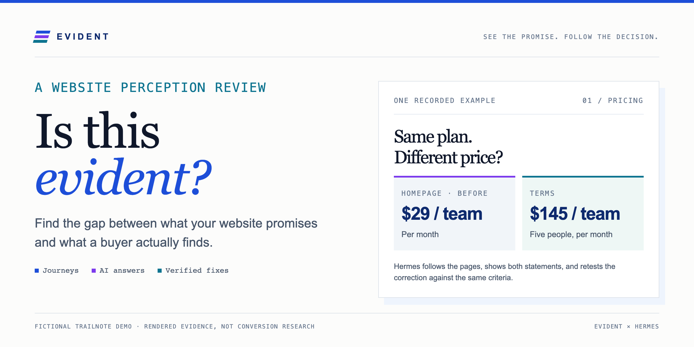
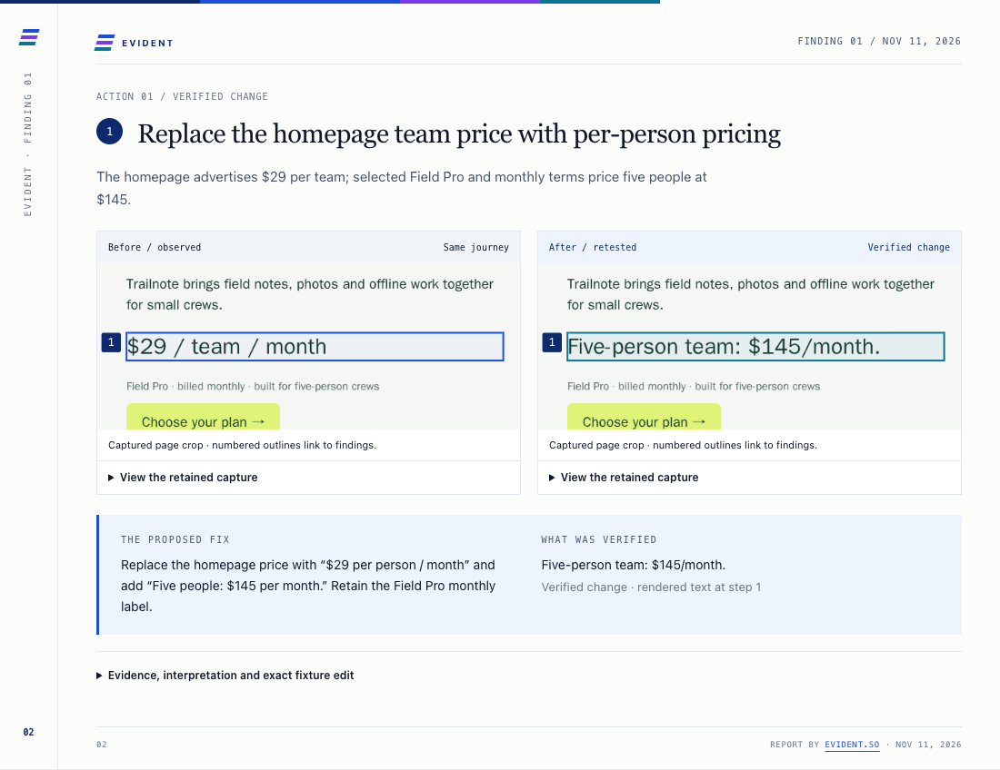
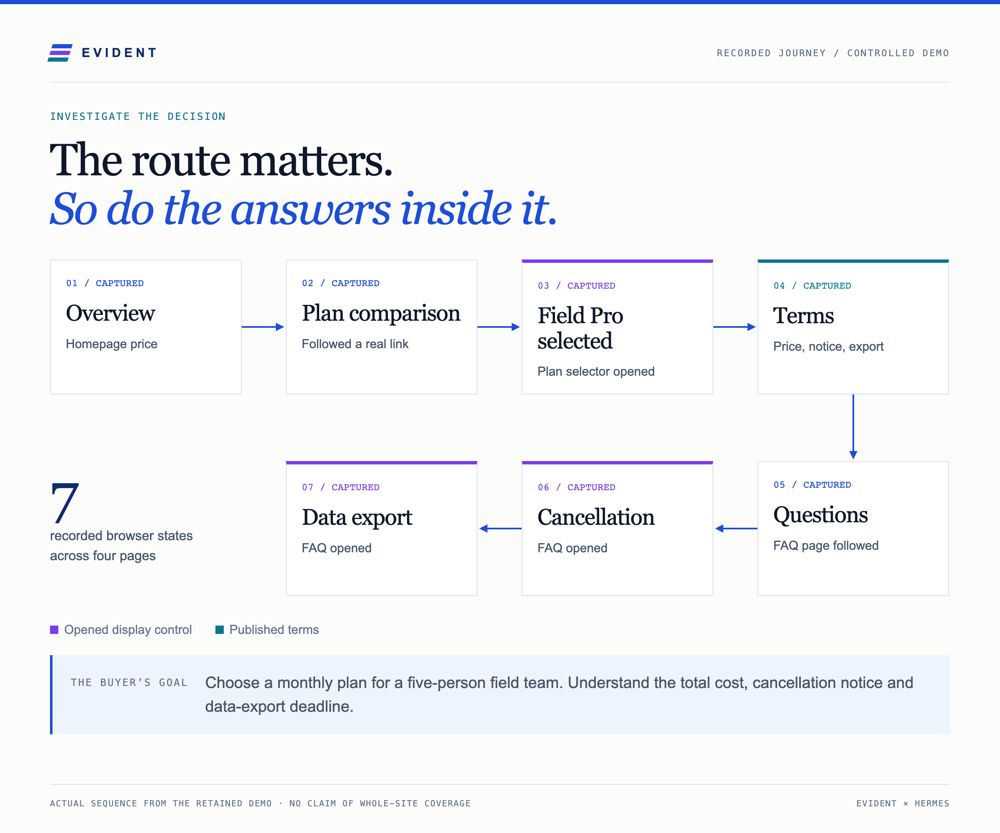
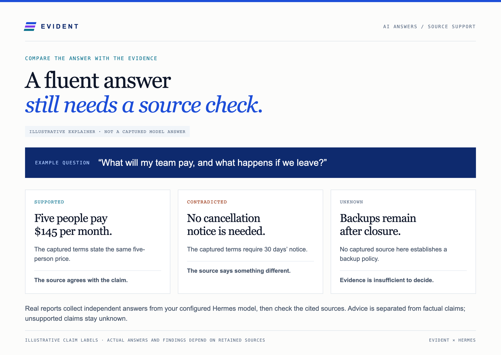
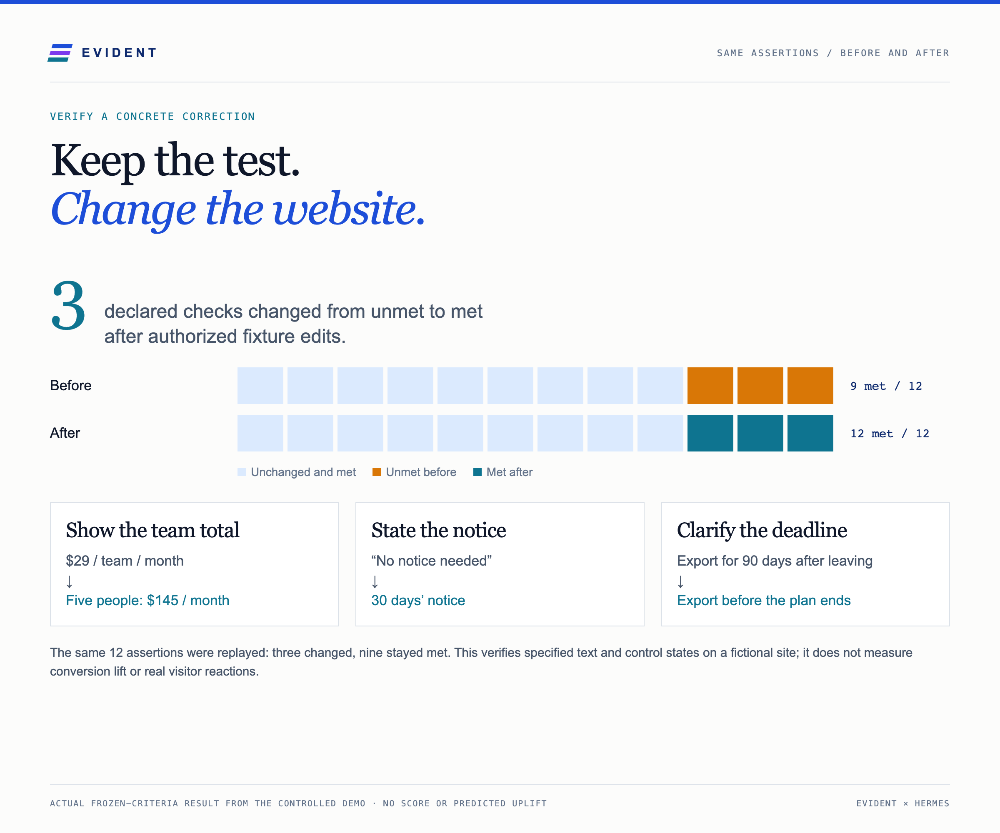

# Evident — Is this evident?

Your website makes a promise. **Can a buyer follow through?** Give Hermes a URL and a goal. Evident follows relevant pages, opens supported FAQs and selectors, and returns one visual report with highlighted evidence and practical changes.

```sh
hermes plugins install evident-evidence --enable
```

After [first-time setup](docs/REFERENCE.md#first-time-setup), start a fresh Hermes chat: **“Is this evident?”** Ask for a general review or a decision such as choosing a plan. Returning sites can recall their saved goal.

## The aha: show the mismatch, then the correction

In this fictional Trailnote demo, the homepage says **$29 per team**, while the terms say **$145 for five people**. Hermes exposes both statements and replays the same check after the fixture is corrected.



*Real browser captures from a fictional controlled site. The demo changes only its own fixture. A normal review observes your website; approved host tools or the site owner make changes.*

## Follow the decision, including the hidden answers



Relevant paths depend on the site and goal. Missing pages, blocked controls and uncaptured handoffs stay visible rather than becoming invented findings.

## Check what the AI answer is based on



Reports include independent answers from the model Hermes already uses, source checks and suggested competitor comparisons. Competitors are editable; unavailable evidence stays labelled. [See an actual competitor-report page](docs/competitor-report.png).

## Verify a fix instead of declaring victory



Save a user-confirmed expected statement, make the authorized correction, and replay its page, element and control-state criteria. A missing page, ambiguous identity or changed conditions can be **inconclusive**. The chart above is a recorded fixture result, not a website score or promised improvement.

## Return to the same business and goal

| Say | What Evident can do |
| --- | --- |
| “Is this evident?” | Guide you to a URL and a general or goal-focused review. |
| “Can a five-person team understand this plan?” | Investigate the decision with that goal. |
| “Those aren’t my competitors.” | Remember your competitor corrections for this site. |
| “What do you remember about this site?” | Show profile-local goals, confirmed facts and prior findings. |
| “Check the correction again.” | Replay a saved test after its criteria are confirmed. |

*Illustrative requests. Hermes’s wording varies with its configured model and available evidence.*

## Setup and scope

- **Supported:** Linux and macOS, Python 3.11+, a compatible Hermes plugin host and a vision-capable configured model for interpreted reports.
- Install managed Chromium in the Hermes runtime, and explicitly enable browser capture and model interpretation in this plugin’s settings. Both start off. When enabled, captured page text and screenshots are sent to your configured Hermes model; usage costs can apply.
- Reviews are bounded anonymous observations. Sign-ins, purchases, form submissions and protected account journeys are outside scope.
- Saved reports, captures and site memory are stored in the active Hermes profile. There is no telemetry or upload to Evident. Reports can include an optional [Evident](https://evident.so/) deep-report link.
- Public review questions are independently defined and unscored. No private factor registry, weights, proprietary evaluation method or conversion prediction is included.

[Full setup, compatibility, privacy, budgets and verification reference](docs/REFERENCE.md) · [Public review questions](PUBLIC_CHECKS.md) · [Visual provenance](docs/VISUALS.md)

Licensing has not yet been specified.
